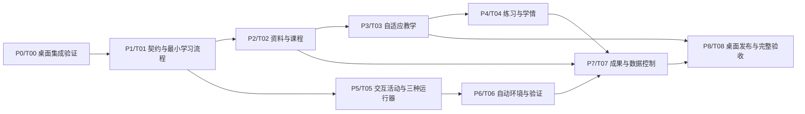

# 分阶段实施计划

状态：实施计划 v1；产品范围已经确认，技术方案需按阶段证据冻结。本聊天维护需求与计划，用户自行指定和派发实现 agent。

## 交付原则

先打通真实桌面上的一条完整学习流程，再增加资料类型、教学策略、学习评价、实验运行与可迁移成果。每阶段产出可检查证据。最终 v1 必须覆盖 R01–R40，早期演示不替代后续要求。

第一个阶段处理平台事实，第二阶段冻结协作契约。此后按稳定 interface 分配 module；存在共同配置或语义依赖的工作串行整合。界面和知识库工作可以并行，但必须使用同一活动、来源和学习记录语义。

## 依赖关系

## 阶段与退出条件

| 阶段 / 任务 | 交付 | 退出条件 |
| --- | --- | --- |
| P0 / T00 | 固定目标桌面版本与官方来源；最小 bundle/Host/Client spike；真实能力清单 | 在目标桌面加载和卸载插件，展示持久教学区域，完成 Host 往返、当前模型调用及重启恢复最小验证；安装路径/运行时有证据。缺少桌面时仅报告 preflight，不标完整通过。 |
| P1 / T01 | 构建与测试入口；公共契约、本地存储版本；单份文本资料的一条真实学习流程 | 学生选课程、问概念、查看原文、操作一个活动、回答一题、重启续学可运行；来源和活动修订/尝试独立性有 integration test。 |
| P2 / T02 | A–E 全格式资料导入、课程草案确认、跨课检索、引用、增量变化与问题清单 | 各格式真实样例解析并定位原文；扫描公式不确定性可见；更新影响与确认有效；已就绪课程能在后台导入时继续学习。 |
| P3 / T03 | 按基础/目标教学、临时追问与恢复、多形式选择、来源/补充/冲突、联网与双语 | 中英材料下完成目标驱动讲解；断网/不足信息不造依据；来源、条件和类比边界可查；切换方式与回到课程路径有效。 |
| P4 / T04 | 多类练习、提示与答案控制、掌握证据、错题与争议、复习 | 跳过/看答案/辅助完成不误报独立掌握；主客观评价保留依据；学生纠正和重检、跨次档案与复习工作。 |
| P5 / T05 | 持续教学区域，交互图/动画/推导/可编辑代码活动；Python/JS/Scheme 初始 adapters | 修改活动→实际执行/观察→AI依据结果解释；三种语言有真实运行证据；活动与执行版本、取消、恢复、重连一致。 |
| P6 / T06 | 新环境识别配置、失败恢复、客观核验、资源降规模 | 完成一种首批范围外的轻量环境扩展样例；独立配置可检验，失败可清理；系统改动选择分支可见；重型任务提供等价教学实验。 |
| P7 / T07 | 笔记/代码/离线交互导出、学习记录管理、本地备份迁移 | 脱离 Harness 且断网可用的页面验证通过；原生实验附运行说明；新路径恢复、缺失原文提示、删除/重置、版本迁移有证据。 |
| P8 / T08 | 可分发桌面插件、安装文档、规模/异常报告、四类课程人工教学验收 | 全部 R 与 AC 对应证据；真实桌面安装/升级/卸载、个人多课程规模及四类学习流程完成；残余问题逐项判定是否阻挡 v1。 |

P5 可在 T01 后与 P2/P3 并行，不代表提前验收 P5 的所有教学整合。T07 的导出 renderer 可在活动契约稳定后先做，其最终退出仍依赖完整记录和运行证据。

## 人员与写入所有权

- 实现负责人：T00、T01、T08；拥有 root manifest、锁文件、构建、宿主桥接与跨 module 契约变更。
- 知识库实现 agent：T02；拥有 Corpus 内部实现和解析/检索 fixtures。
- 教学实现 agent：T03；拥有 Teaching，消费 Corpus 和 Activities interface。
- 学情实现 agent：T04；拥有 Learning 及评价样例。
- 交互与实验实现 agent：T05、T06；拥有 Activities、Experiments 及各运行 adapters。
- 成果与数据实现 agent：T07；拥有 Portability；存储迁移与删除行为通过 LocalState interface 与实现负责人整合。

人员是建议角色，由用户决定实际 agent 与派发时间。建议先分配 T00；T01 通过后可并行分配 T02 与 T05，之后根据依赖推进。本计划不会自动创建或派发 agent。源码目录由 T00/T01 实际冻结，任务不能凭提案路径自行抢占公共文件。

## 每次交接的完成证据

按 [handoff/START-HERE.md](../handoff/START-HERE.md) 输出：任务状态、改动范围、R/AC、环境/宿主版本、实际命令结果、人工操作结果、局限与下一步。证据写 `docs/evidence/Txx.md`。

可用状态为：未开始、进行中、待外部条件、待整合、验证通过。状态按事实更新；仅“编译成功”不算桌面运行验证通过。学习效果人工评审与自动化测试分开报告。

## 未量化事项

当前没有经过验证的工期、人日、费用和时延数字。T00/T01 固定技术基线，T02/T05 测量典型活动成本与耗时，T08 汇总规模结果。需要硬上限时协调者给出实测基础上的提案；不能在实现中悄悄把模型调用设为无限重试，或为了指标减少需求。
