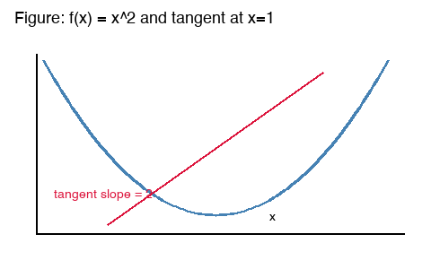

# 导数与变化率

导数描述函数在一点处的瞬时变化率，是微积分的核心概念之一。英文术语为 derivative。

## 直观定义

当自变量的增量趋近于零时，差商的极限就是导数：

$$
f'(x) = \lim_{h \to 0} \frac{f(x+h) - f(x)}{h}
$$

如果该极限存在，则称函数在 $x$ 处可导（differentiable）。

## 计算示例

对 $f(x) = x^2$ 求导，由幂函数法则得到 $f'(x) = 2x$。
在 $x = 1$ 处，切线斜率为 2。



## 常用求导法则

- 幂函数：$(x^n)' = n x^{n-1}$
- 和法则：两个可导函数之和的导数等于导数之和
- 链式法则：复合函数求导需要乘以内层函数的导数

## 数值求导代码

```python
def numeric_derivative(f, x, h=1e-6):
    """中心差分近似一阶导数."""
    return (f(x + h) - f(x - h)) / (2 * h)

print(numeric_derivative(lambda t: t * t, 1.0))  # 约等于 2
```

## 概念对照

| 中文 | English | 含义 |
| --- | --- | --- |
| 导数 | derivative | 瞬时变化率 |
| 可导 | differentiable | 差商极限存在 |
| 切线 | tangent line | 局部线性近似 |

> 注意：可导必连续，但连续不一定可导；反例是 $f(x) = |x|$ 在 0 处。

### 易错点

学生常把"导数为零"直接当成"极值点"，实际还需要检查两侧符号是否变化。
